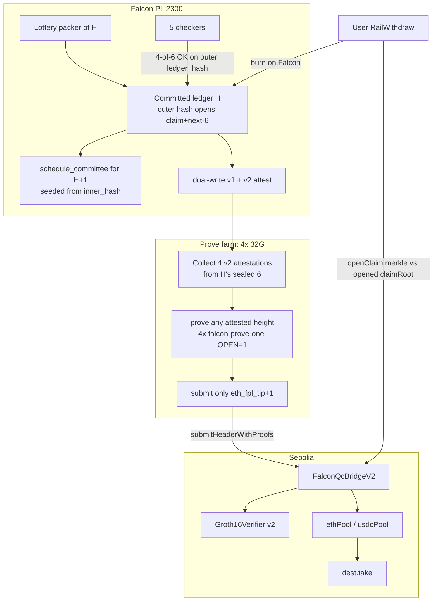

# Falcon PL lottery-6 light client on Sepolia

**Subtitle:** Mainnet-standard *theft bar* for ETH/USDC peg-out (rotating 4-of-6; `claimRoot` opened on-chain from the hash Groth16 signs). Testnet unwrap is lagged unless multi-host prove keeps up.  
**Author:** Falcon PL / systems design  
**Date:** 2026-09-14  
**Status:** Draft (rev 4 — OQ1 strand + document)  
**Product:** Falcon PL public testnet 2300  
**Supersedes:** live `FalconQcBridge` v1 (`fpl-falcon-qc-v1`, immutable `falconKeyRoot`) and live `FalconDestLock` claimer Kickoff

---

## Overview

Live Sepolia ETH/USDC peg-out is not mainnet-standard. Wallet unwraps go through `FalconDestLock` `0xdBF6855b00B78c047A729A21E13bfE5f4C991C05`, whose `claimer` `0xDb52847EE70cEd3128f49309c3DC65b69d7466f4` may `kickoff(noteId, dest, amount)` to **any** dest and drain the pool. A parallel Groth16 header bridge `FalconQcBridge` `0xf8F1471643792eb1cD5d0C31061629777E55bc48` exists, but its committee is a **frozen** MiMC `falconKeyRoot` of the original v1–v5 keys. Live `falcon-pl-ctl status` on v1 at **2026-09-14T08:09:17Z**: mesh `tip_height=350558`, `qc_committee=['v9','v3','v12','v10','v6','v11']`, `commit_need=4`. Sepolia `fplTip()=327507`. Bonded unjailed seats are v1/v3/v6/v9/v10/v11/v12; v2/v4/v5/v7/v8 are jailed. Frozen prover pubs on disk are only `keys/falcon-qc/v1.pub.json`…`v6.pub.json`. Four colluding seats can also attach a **sidecar** `claimRoot` that v1 never opens from `header`.

This design replaces both unwrap paths with a new contract and a new Groth16 domain `fpl-falcon-qc-v2`. Ethereum tracks the **same lottery 6** that QC that Falcon height (1 packer + 5 checkers, tip advances on 4-of-6). Each proven header’s **outer hash** is `sha256(raw "pl-ledger:v4-seal" || inner_hash[32] || next_root[32] || claim_root[32])`. Groth16 verifies 4 Falcon-512 signatures over that hash. Solidity `require`s the same preimage. A fake `claimRoot` is a different hash. Ethereum accepts any sequential outer hash signed by 4 of `C(H)` — that is an **LC fork** at the same 4-of-6 bar as Falcon, not a requirement that the mesh packed that header first. The contract rotates via an Altair-style **next committee** committed in that hash. Signers cannot `take()` or `kickoff`; there is no owner.

Peg-in stays dest-lock / ETH LC (watchers cannot mint to a different dest20). This document is **peg-out + header relay**. Dest-lock bytecode cannot grow headers. After a time-boxed user-dest Kickoff window, leftover dest-lock and v1 QC pools are **stranded testnet funds** (no socialized rescue into V2). **Safety** (theft bar) is mainnet-standard. **Liveness** on one 32G prover is not: sequential OPEN=1 is slower than mesh. PR 6 budgets four 32G prove hosts (prove any attested height, submit `tip+1` only). One-host operation is a lagged testnet unwrap, not a 32-height SLA.

---

## Background & Motivation

### Current Falcon consensus (do not change the sample)

Falcon PL v2.9.0+ (`/home/falcon/falcon-pl/falcon-pl-rs/crates/fd-pl/src/lib.rs`):

- `ChainConfig.committee_size` default **6** (1 packer + 5 checkers).
- `Node::draw_committee` = first 6 of the full lottery walk.
- `Node::lottery_order` returns the freeze `schedule_committee` **filtered to currently bonded** when `schedule_height == tip+1` (`lib.rs` 5228–5242). That filter is **not** what v4 seals (see Key Decision 10 / header fields).
- Lottery seed (`lottery_packer_with_skips`, v2.8.1 / v2.9.2):

  ```text
  sha256("lottery|v7|{network_id}|{height}|{tip_hash}|prev:{packer}|set:{id:bond,…}")
  ```

  Bonded non-jailed seats only. Same committed tip ⇒ same 6. ONLINE/pong is pack permission, never a seed input. After v4, freeze/draw for H+1 uses `lottery|v8|…|{inner_hash}|…` (not `self.tip_hash`, which stays the outer hash).
- `commit_votes_needed` = **4** when `|lottery_order| ≥ 6`.
- On commit (`lib.rs` ~7182 / ~7241): `self.tip_hash = ledger.ledger_hash` then `freeze_open_height_schedule()` → `draw_committee()` → `lottery_packer_with_skips` seeded by `self.tip_hash`. That is the v3 cycle v4 must break.
- `LedgerCert` (4-of-6) rides the **next** header as `parent_cert` (`header_msg_v3`).
- `Ledger::seal_with_skips` / `verify_packer`: `ledger_hash = sha256_hex(format!("{msg}|{packer_sig}"))` (`crypto.rs` `sha256_hex` = lowercase hex of SHA256). `msg` is `header_msg_v3` and does **not** contain `claim_root`.

### Current Groth16 statement (insufficient)

`fd-pl-snark` `statement_bytes` (`crates/fd-pl-snark/src/falcon/native.rs`):

```text
b"fpl-falcon-qc-v1" || height_be8 || parent32 || header32 || claim32 || network_id_be4
```

`FplFalconQcCircuit` (`circuit.rs`) verifies `OPEN` Falcon-512 signatures whose packed public keys merkle (`merkle8` / `MAX_LEAVES=8`) to public `key_root`. Live path is four `OPEN=1` proofs; the 11th public input is `signerIndex` so Solidity can require distinct indices `0..7`.

The circuit **does not** check that `claimRoot` is inside `header`. `falcon_qc::attest_committed` is a **sidecar** written after commit (`lib.rs` ~7252): it signs the v1 statement with the node Falcon key, independent of `vote_ok_payload` (`pl-ok:v1|{nid}|{height}|{ledger_hash}|{voter}`). Four seats in the frozen 8-leaf key root can attest a fake claim tree for a real `ledger_hash`.

`MAX_LEAVES=8` **can** describe 7 live packers (7 keys + 1 dummy). The live break is an **immutable** root of the original keys (`keys/falcon-qc` v1–v6 pubs), not 8 < 7.

### Live Sepolia (ctl dump 2026-09-14T08:09:17Z)

Queried `falcon-pl-ctl --addr 127.0.0.1:19301 status` (seat `id=v1`) and `cast call` against Sepolia RPC.

| Piece | Address / value | Failure |
|---|---|---|
| Wallet peg-in | `FalconDestLock` `0xdBF6855b00B78c047A729A21E13bfE5f4C991C05` | No owner, no admin withdraw, no headers. Fine for deposits. |
| Wallet peg-out | claimer `0xDb52847EE70cEd3128f49309c3DC65b69d7466f4` `kickoff` then dest `take()` after `claimDelay=6` | Claimer chooses dest → can drain the pool. Dest-lock `ethPool=1e17` (0.1 ETH), `usdcPool=2e7` (20 USDC, 6 decimals). |
| Header bridge | `FalconQcBridge` `0xf8F1471643792eb1cD5d0C31061629777E55bc48` | `falconKeyRoot` **immutable**; Groth16 public input 7. `ethPool=1.8e16` (0.018 ETH), `usdcPool=8e6` (8 USDC). |
| Verifier | `0x9992cD8e45A2b7983E2b7f8fC725308a0E4845EC` | Tied to v1 `pk.bin`. |
| Start height | 326444 (`run/bridge/sepolia-qc.json`) | — |
| `fplTip` / mesh | `327507` / **`350558`** | Lag 23051. Author-reported `~350452` was the same outage, earlier in the day. |
| Live 6 | `qc_committee=['v9','v3','v12','v10','v6','v11']` | Frozen pubs are v1–v6 only. |
| Bonded unjailed | v1, v3, v6, v9, v10, v11, v12 (7) | v2/v4/v5/v7/v8 jailed. v1 bonded but not in this height’s 6. |
| Prover | `pl-falcon-qc-prover.py`, `SAMPLE_GAP=48`, `MemoryMax=32G` | Idle: `committee_index()` = `sorted(*.pub.json)[:8]` = v1–v6. Committee growth **breaks** frozen root. |
| Wallet unwrap | `Falcon-faucet-wallet/src/lib/pl-dest-lock.ts` `pegOutDestLock` | POST `/api/wallet/pl` `eth-kickoff`. An older `src/app/api/wallet/pl-dest-lock.ts` still talks `openClaim` + `submitHeaderWithProof` (BabyJub-era ABI). |
| LC claim tree | `lc.claim_root=9671942a…cfa5`, 9 leaves | ETH rail 5 leaves / 5 open wd; USDC 4 leaves / 4 open wd. Cumulative. |

v1 `submitHeaderWithProofs` allows **height jumps**: parent is checked only when `height == fplTip + 1`. That is how `SAMPLE_GAP=48` catch-up works today. It is safe only because the signer set is frozen. It is **not** safe once the 6 rotate.

### Pain

1. Operator claimer = custodian of the ETH/USDC pool.
2. Frozen key root cannot follow lottery 6; joining v9–v12 makes Groth16 unsatisfiable against the deployed vk. `MAX_LEAVES=8` was not the limiter.
3. Unbound sidecar `claimRoot` lets 4 colluding seats steal without forging the Falcon tip.
4. Vestigial `challengeClaim` on `FalconQcBridge` can never fire for a claim that passed `openClaim` (it requires `withdrawLeaf != c.leaf`).

---

## Goals & Non-Goals

### Goals

- Ethereum attests the **same 6** that QC that Falcon height (lottery 6, 4-of-6).
- `claimRoot` and next-6 are committed in the **outer hash** Groth16 signs and Solidity opens. Forging a withdraw tree = forging a Falcon `ledger_hash`.
- No owner, no signer `take()`, no `kickoff`, no admin withdraw.
- `openClaim` = sha256 merkle of `evm-wd-v1|note|dest|amount|flag` vs header `claimRoot`; only dest `take()`.
- New circuit domain, new Groth16 setup, new contract. Old QC pool stays on old bytecode. Dual-write v1+v2 attestations until the v1 unit stops.
- Peg-in remains dest-lock / ETH LC (`eth_lc.rs` Altair sync committee + receipt MPT). Watchers relay; they cannot mint.
- Implementable as ordered PRs: header binding → dual-write attestation → circuit → setup → contract → multi-host prover → wallet cutover → dest-lock leftover.

### Non-Goals

- Do not Groth16 every Falcon height as a *product requirement* of Falcon consensus (proofs are ~minutes, ~6 GiB RSS each). Sampled **claim** headers are allowed only if the **committee chain** is intact (see Key Decision 4). This generation does **not** jump.
- Do not invent a second random committee or an Ethereum-style 512-sync-committee sample. ETH must not attest a different 6 than Falcon.
- Do not freeze genesis keys. Bonded join/leave is already certified by the 6.
- Do not reuse `fpl-falcon-qc-v1` `pk.bin` / vk. Do not replace `statement_bytes` / `STATEMENT_DOMAIN` used by the live v1 prover.
- Do not migrate dest-lock bytecode in place (no owner, no upgrade slot).
- Do not change ETH-in (Sepolia LC). Do not change BTC BitVM2 Kickoff.
- Do not ship recursive / IVC SNARKs in this generation (called out as future liveness work).
- Do not Groth16 OPEN=4 as the live path (setup OOM at 15 GiB; 9.7M constraints).
- Do not claim one-host unwrap latency is mainnet-grade.

---

## Key Decisions

1. **Follow Falcon lottery 6; threshold is 4 of that height's 6.**  
   Rationale: `draw_committee` / `commit_votes_needed` already are 4-of-6. A frozen 4-of-8 key root is a different committee and has already failed in ops.

2. **ETH attests the same 6 that QC'd that height. No second sample.**  
   Rationale: a 512-sync-committee analogue would let ETH accept headers the Falcon tip did not, or reject headers it did.

3. **Altair-style next committee, not a frozen root.**  
   Header H commits the next 6 (lottery after applying H, seeded from **inner_hash**). 4-of-current-6 sign the outer hash that includes that next-6 root. Contract stores current 6 (pk-leaf merkle) and rotates on accept. Analog: `eth_lc.rs` `current_pks` / `next_pks` + `NEXT_SYNC_COMMITTEE_GINDEX`, with committee size 6 not 512.

4. **No Falcon-height jumps for committee rotation.** `submitHeaderWithProofs` requires `height == fplTip + 1` and `parent == headers[fplTip].hash`.  
   Rationale: lottery seed includes `height`, tip seed, `prev_packer`, and the bonded set. The 6 of height B are not the 6 of height A unless B = A+1 (or a full next-6 chain is proven). Option (b) — jump to B signed by the 6 stored from A — is **wrong**. `SAMPLE_GAP` is retired as a **contract** jump and as an e2e success criterion. This generation proves sequential committee updates from a bootstrap tip.

5. **`claimRoot` is opened on-chain from the hash Groth16 signs. Not a free public input.**  
   Outer hash = `sha256(b"pl-ledger:v4-seal" || inner_hash[32] || next_root[32] || claim_root[32])`. Contract `require(sha256(abi.encodePacked(SEAL_PREFIX, innerHash, nextCommitteeRoot, claimRoot)) == hash)`. Groth16 statement is `fpl-falcon-qc-v2 || height || parent || hash || nid` — **no unconstrained `claim` field**. Fake claim ⇒ different `hash`. Parent/seq do **not** reject a sequential steal hash; 4-of-`C(H)` can LC-fork ETH without a Falcon commit (same keys as consensus forge). Attestation slash is **deterrence**, not this bind.

6. **Two-stage ledger hash so next-6 does not cycle; freeze draws from inner_hash.**  
   Next-6 = `f(inner_hash, bonded_after_H)`. `inner_hash` does not include next-6. Outer `ledger_hash` includes next-6 **and** `claim_root`. `self.tip_hash` stays the **outer** hash (parent / `vote_ok_payload`). After v4, `freeze_open_height_schedule` / `lottery_packer_with_skips` seed from `chain.last().inner_hash`, not `self.tip_hash`. Lottery tag `lottery|v8|…`.

7. **Keep 4× OPEN=1 Groth16, not one OPEN=4 proof.**  
   Rationale: one Falcon-512 ≈ 2.42M constraints; OPEN=4 ≈ 9.68M, Groth16 setup OOM at 15 GiB. Live prover already parallelizes four `falcon-prove-one` (~6 GiB RSS each). systemd `MemoryMax=32G`; drop-ins have used 14G and OOM-killed. Stay on OPEN=1.

8. **New domain `fpl-falcon-qc-v2`, new ptau contribute, new `pk.bin`, new verifier, new contract.** Dual-write `statement_bytes` (v1) and `statement_bytes_v2`.  
   Rationale: R1CS public IO changes. Replacing `STATEMENT_DOMAIN` poisons live v1 sigs.

9. **`openClaim` merkle vs header `claimRoot`; only dest `take()`.** Cumulative claim tree (`record_evm_withdraw` appends; `evm_header_claim_root` is ETH∥USDC leaves). A later proven header still contains earlier withdraw leaves, so `openClaim` at H ≥ W is valid.

10. **`current_committee_root` is merkle of the sealed 6 pks for that height, not `lottery_order()` after the bonded filter.** Mid-height unbond does not rewrite the sealed 6. After `qc_start_height`, **every committed height must carry a full v4 outer seal** (6 current ids, 6 next ids, claim, hash). If `|bonded_after_H| < 6` so next-6 cannot fill 6 seats, **do not pack/commit** — Falcon stalls with the LC. Do not skip a sequential height (that deadlocks `height == fplTip+1`). Do not lower ETH `proofsNeeded`.

11. **Bootstrap V2 at a v4 mesh height S. `startCommittee` = `C(S+1)` = next-6 in header S, not the 6 who signed S.** Constructor `headers[S].claimRoot` = mesh `claim_root` at S. Do not replay 23k v1 headers.

12. **Slash QC-attestation equivocation as deterrence** (new evidence type, two v2 messages + Falcon sigs, burn `slash_equivocation`). Does **not** revert an already-accepted Sepolia header. LC safety is the on-chain hash opening.

13. **This-generation liveness: four 32G prove hosts, prove-any / submit-`tip+1`.** One host is an honest lagged testnet unwrap. No jumps.

14. **Dest-lock residual and v1 QC residual: strand + document.** Stop new dest-lock deposits. Kickoff only to the user’s signed burn `external_to`. No operator self-dest. Leave leftover as stranded testnet funds. Publish v1 QC **0.018 ETH + 8 USDC** as unrecoverable (`<4` frozen-root live signers). **Do not** socialize rescue into V2.

---

## Proposed Design

### Architecture



Peg-in (unchanged):

```mermaid
sequenceDiagram
  participant U as User
  participant DL as FalconDestLock or V2 deposit
  participant W as Watcher / eth_lc
  participant F as Falcon mint
  U->>DL: depositEth(dest20) / depositUsdc
  W->>W: Altair LC + receipt MPT
  W->>F: relay Deposit log
  Note over F: dest20 bound in log; watchers cannot retarget
```

Peg-out (new):

```mermaid
sequenceDiagram
  participant U as User
  participant F as Falcon tip
  participant P as QC prove farm
  participant C as FalconQcBridgeV2
  U->>F: RailWithdraw ETH/USDC dest=0x…
  F->>F: record_evm_withdraw appends leaf
  F->>F: v4 seal; 4-of-6 OK on outer hash
  P->>P: 4x OPEN=1 Groth16 over hash
  P->>C: submitHeaderWithProofs(H=tip+1)
  C->>C: sha256 open hash; verify 4 idx in current 6; rotate
  U->>C: openClaim(note, dest, amount, proof, index, H≥W)
  U->>C: take() as dest
```

### Header fields (v4 two-stage seal)

Today (`Ledger::header_msg_v3` / `seal_with_skips`):

```text
msg = pl-ledger:v3|{height}|{parent_hash}|{network_id}|{packer}|{tx_root}|{state_root_after}|skips:{…}|cert:{parent_cert_hash}
ledger_hash = sha256_hex("{msg}|{packer_sig}")   // ASCII pipe; lowercase hex
```

`state_root_after` = `commitment_root()` (accounts + defi + **whole `BridgeState`** + validator slim + claimable). ETH/USDC `claim_leaves` are already inside that JSON, so a full-node re-execution sees the real tree. The light client does not open JSON.

#### Pack pipeline (PR 1 — exact order)

`Ledger::seal_with_skips` today has no bonded-set or claim-root arguments. Next-6 cannot be computed there without `Node` state after apply. Pack lives on `Node`:

1. Apply txs against a draft (`draft_state` / `draft_bridge` / `draft_vals`) → `state_root_after = commitment_root()`.
2. `claim_root = evm_header_claim_root(&draft_bridge)` (ETH leaves then USDC, `evm_spv::build_tree`).
3. `current_committee` = **sealed** 6 ids frozen at open-height (`schedule_committee` **unfiltered**). `current_committee_root = committee_key_root(pks)` with merkle8 dummy pad at indices 6,7. Leaf order = sealed lottery order (packer = index 0). Do **not** call `lottery_order()` (bonded filter) before hashing.
4. Packer signs inner msg (variable-length; Solidity never opens this):

   ```text
   msg_v4 = pl-ledger:v4|{height}|{parent_hash}|{network_id}|{packer}|{tx_root}|{state_root_after}|skips:{skips}|cert:{parent_cert_hash}|claim:{claim_root_hex}|cur6:{current_committee_root_hex}
   inner_hash = sha256("{msg_v4}|{packer_sig}")     // same ASCII-pipe rule as v3
   inner_hash stored as 32 raw bytes (decode the lowercase hex)
   ```

   `claim_root_hex` / `current_committee_root_hex` = 64 lowercase hex chars, no `0x`. `current_committee_root` is Fr BE (same as v1 `falconKeyRoot` / `fr_to_be_hex`).
5. If `|bonded_after_H| < 6` (next-6 walk cannot yield 6 distinct bonded ids): **abort pack / do not commit**. After `qc_start_height` Falcon must not advance a height the LC cannot take. Small-set `commit_votes_needed` is **disabled** for v4 heights — no “commit without a relayable header.” ETH `proofsNeeded` stays 4. PR 1 test: a 5-bonded draft fails pack (does not produce a hole at `fplTip+1`).
6. Draw next-6 from **inner_hash**, not outer hash (only reached when `|bonded_after_H| ≥ 6`):

   ```text
   seed = sha256("lottery|v8|{network_id}|{height+1}|{inner_hash_hex}|prev:{packer}|set:{id:bond,…}")
   ```

   - `network_id` = `cfg.network_id` (2300)
   - `height+1` = this ledger’s height + 1 (same as today’s `lottery_packer_with_skips` using `tip_height+1` after commit)
   - `inner_hash_hex` = 64 lowercase hex of the 32-byte inner_hash (**not** `ledger_hash`)
   - `prev` = this ledger’s `packer`
   - `set` = bonded non-jailed after H, `id:bond` joined by comma, ids sorted as today
   - `next_committee` = first 6 of that walk (ids)
   - `next_committee_root` = `committee_key_root` of those 6 pks, merkle8-padded, Fr 32-byte BE
7. Outer hash (fixed-width; **this** is `ledger_hash` / `vote_ok_payload` / parent of H+1 / Groth16 `header`):

   ```text
   SEAL_PREFIX = bytes("pl-ledger:v4-seal")     // 16 bytes, no trailing NUL
   ledger_hash = sha256(SEAL_PREFIX || inner_hash[32] || next_root[32] || claim_root[32])
   ```

   112-byte preimage. No hex, no extra pipes. `next_root` and `claim_root` are raw 32-byte values (Fr BE and sha256 merkle root respectively).

Fork boundary: **`C(S)`** (the 6 who QC the first v4 ledger S) is still **v7** from the v3 parent tip. **`C(S+1)`** is **v8** from S’s `inner_hash`. Constructor stores `C(S+1)`.

#### Checker verification (consensus, not SNARK)

1. Re-apply txs; `state_root_after` matches `commitment_root`.
2. `claim_root` == `evm_header_claim_root`.
3. `current_committee` / `current_committee_root` == **sealed** 6 pks (unfiltered freeze), merkle8.
4. `inner_hash` / packer_sig verify under the ASCII-pipe rule.
5. Recompute next-6 from the v8 seed above; ids and `next_committee_root` match.
6. `ledger_hash` == sha256(SEAL_PREFIX || inner || next_root || claim_root).
7. OK vote remains `pl-ok:v1|{nid}|{height}|{ledger_hash}|{voter}` — `ledger_hash` is the outer hash.

#### Freeze after commit (must not use outer `tip_hash`)

Live order (`lib.rs` ~7182, ~7241):

```text
self.tip_hash = ledger.ledger_hash.clone();  // OUTER — keep for parent / OK
self.chain.push(ledger);
self.freeze_open_height_schedule();          // MUST NOT seed from self.tip_hash
```

After v4 activation (`height >= qc_start_height`):

```text
fn lottery_tip_seed(&self) -> String {
    match self.chain.last() {
        Some(l) if !l.inner_hash.is_empty() => l.inner_hash.clone(), // 64 lowercase hex
        _ => self.tip_hash.clone(),
    }
}
```

`lottery_packer_with_skips` uses `lottery_tip_seed()` in the v8 string when `tip_height >= qc_start_height`, else v7 + `self.tip_hash`. `prev_packer` = `chain.last().packer`. Bonded set = current `bonded_ids()` (post-commit state already applied).

`freeze_open_height_schedule` then `draw_committee()` from that seed. Cross-seat test (mandatory in PR 1): same committed H ⇒ same `inner_hash`, same next-6 **ids**, same outer `ledger_hash`, and `schedule_committee` after freeze **equals** the sealed `next_committee` ids (no bonded filter drift at freeze instant).

Optionally also **install** `schedule_committee = ledger.next_committee` after verifying it against the header (review option b). Do both: draw-from-inner_hash **and** assert equality with sealed ids.

#### `Ledger` / `LedgerHeader` new fields

Gossip is header-only (`ProposeHeader`). `verify_packer` on ingest needs the same fields on `LedgerHeader`. Serde: `#[serde(default)]` plus `skip_serializing_if = "String::is_empty"` / `Vec::is_empty` on **these new fields only**, same idea as `RailState.bitvm2_claim_root` (v2.9.43) so pre-v4 snaps still hash. Do not add `skip_serializing_if` to existing `Ledger` fields.

```rust
pub claim_root: String,                 // 64 lowercase hex, no 0x
pub current_committee_root: String,     // Fr BE hex
pub next_committee_root: String,        // Fr BE hex
pub inner_hash: String,                 // 64 lowercase hex of inner sha256
pub current_committee: Vec<String>,     // sealed 6 ids, lottery order
pub next_committee: Vec<String>,        // next 6 ids
```

`verify_packer` tries v4-seal first, then v3/v2/v1 fallbacks only if the new fields are empty (pre-fork ledgers).

#### Exact encodings (Solidity must match outer)

| Item | Encoding |
|---|---|
| Inner msg | UTF-8 `pl-ledger:v4\|…\|claim:{64hex}\|cur6:{64hex}` |
| Inner hash input | `msg_v4` ASCII `\|` `packer_sig` (hex string of the Falcon sig, same as v3) |
| `inner_hash` stored | 32 bytes = SHA256 of that input; displayed as 64 lowercase hex |
| `SEAL_PREFIX` | 16 bytes `70 6c 2d 6c 65 64 67 65 72 3a 76 34 2d 73 65 61 6c` = `"pl-ledger:v4-seal"` |
| `next_root[32]` | MiMC merkle8 Fr, **big-endian** 32 bytes (same as v1 `bytes32 falconKeyRoot`) |
| `claim_root[32]` | sha256 binary merkle root, raw 32 bytes |
| Outer `ledger_hash` | SHA256 of `SEAL_PREFIX \|\| inner_hash \|\| next_root \|\| claim_root` (112 bytes) |
| Solidity | `sha256(abi.encodePacked(bytes("pl-ledger:v4-seal"), innerHash, nextCommitteeRoot, claimRoot))` — `abi.encodePacked` on `bytes` + three `bytes32` is concatenation, no length prefixes |
| Hex in msgs | lowercase, width 64, **no** `0x` |

PR 1 ships a test vector: one sealed v4 header → `msg_v4`, `inner_hash`, next-6 ids, `next_root`, `claim_root`, outer `ledger_hash`, v2 statement bytes, and a Solidity `assert` of the opening.

### Attestation (dual-write; slash is not the bind)

Keep `native::STATEMENT_DOMAIN` / `statement_bytes` **unchanged** for v1 (`fpl-falcon-qc-v1`, 124 bytes). Add:

```rust
pub const STATEMENT_DOMAIN_V2: &[u8] = b"fpl-falcon-qc-v2"; // 16 bytes

pub fn statement_bytes_v2(
    height: u64,
    parent: &[u8; 32],
    header: &[u8; 32],          // outer ledger_hash (already binds claim+next)
    network_id: u32,
) -> Vec<u8> {
    // domain || height_be8 || parent32 || header32 || nid_be4
    // 16+8+32+32+4 = 92 bytes. NO free claim field.
}
```

`falcon_qc::attest_committed` after commit:

- Always recompute `claim` / `next` / `header` from the committed ledger; refuse mismatch.
- If `height <= qc_start_height` or v1 unit still running: **also** write v1 `statement_bytes` sigs (same filenames as today) so the live prover is not poisoned.
- If `height >= qc_start_height`: write v2 sigs to `keys/falcon-qc/sigs-v2/{height:010}-{seat}.json` (separate dir — do not mix 92-byte and 124-byte statements in one glob).
- Gate on `qc_header_version` / `qc_start_height` in `keys/lc/bridge.json` (extend `LcBridgeCfg`; today it only has `start_height`, `network_id`, `key_root`).

`FalconQcAttestation` v2 JSON: `height`, `header`, `parent`, `claim_root`, `inner_hash`, `next_committee_root`, `current_committee_root`, `sig`, `pk_hex`. The Groth16 message is **only** `statement_bytes_v2` (hash, not the extra JSON fields). Extra fields are for the prover to pass `innerHash`/`claimRoot` calldata that must open `header`.

**Equivocation slash (deterrence):** new type, not `SlashEvidence` (that is two OK `ledger_hash` values + `pl-ok` sigs).

```rust
pub struct QcAttestSlash {
    pub offender: String,
    pub height: u64,
    pub stmt_a: String, // hex of statement_bytes_v2
    pub sig_a: String,
    pub stmt_b: String,
    pub sig_b: String,
}
```

Burn `ChainConfig.slash_equivocation` (default 100). Packer includes it in `ledger.slashes` (or a parallel vec applied the same way). **Does not** roll back Sepolia. Parent/seq and OK-equivocation do **not** catch a 4-of-`C(H)` who never OK the honest hash and submit only a steal outer hash to ETH (each signed one v2 statement). Optional extra deterrence (PR 2): slash a v2 attestation whose `header` ≠ this height’s committed OK `ledger_hash` when a cert exists. LC safety remains: ETH accepts 4-of-`C(H)` on a sequential opened hash — same key set as Falcon 4-of-6, without requiring a mesh commit.

### Jump analysis (critical)

Let `C(H)` be the lottery 6 of height H = first 6 of the v7/v8 walk from committed tip H−1 (sealed, unfiltered).

Altair on Ethereum: the same 512 sign every slot in a period; `next_sync_committee` is in BeaconState (RANDAO entropy **does not** include the block hash being sealed). Jumps inside a period are safe.

Falcon: `C(H)` changes every height. That is Altair with period length **1**.

| Strategy | Sound? | Why |
|---|---|---|
| (a) Sequential: prove H = tip+1, parent = last proven hash, rotate to next-6 from opened hash | **Yes** | Stored 6 are `C(H)`. Header signed by 4 of `C(H)`. After accept, stored 6 = `C(H+1)`. |
| (b) Jump A → B > A+1, signatures from stored 6 (`C(A+1)`) | **No** | `C(B) ≠ C(A+1)` in general. User-forbidden. |
| (c) Jump A → B, signatures from `C(B)`, replace stored 6 with header's current-6 | **No** | ETH has no authenticator that those 6 *are* `C(B)` without the next-6 chain. |
| (d) Jump A → B, prove a chain of next-6 updates A+1 … B | **Yes** | Equivalent to (a) with optional batching. Each step still needs 4 Falcon-512 verifications. |
| (e) Freeze `C(epoch_start)` for SAMPLE_GAP heights on Falcon | Rejected | Different sample than live lottery 6. |
| (f) v1 SAMPLE_GAP jump with frozen keyRoot | Unsafe for rotation | Why v1 “worked” and why committee growth broke it. |

**Pick (a).** Contract:

```solidity
require(height == fplTip + 1, "seq");
require(parent == headers[fplTip].hash, "parent");
```

`SAMPLE_GAP=48` / `JUMP_LAG` / `pick_on_grid` are **removed** for v2 submit. Grep-gate: v2 units and e2e must not treat `SAMPLE_GAP` as a submit/jump/success criterion (`pl-falcon-qc-v2-prover.py`, `pl-eth-sepolia-e2e.py`, `pl-bridge-e2e-wait.py`, `pl-bridge-health.py` v2 path).

**May we skip proving intermediate ledgers?** Only via (d). A committee-only Groth16 is not cheaper (Falcon-512 dominates). Recursive/IVC folding is future work.

**Claim catch-up:** `record_evm_withdraw` appends; later `claimRoot` still contains earlier leaves. `openClaim` at any proven H ≥ W. Sequential proofs make this automatic.

### Liveness vs mesh rate (quantified; no jumps)

Live: mesh 350558 at 2026-09-14T08:09:17Z vs `fplTip` 327507 (v1). Height rate 2026-09-02→14: ~24 000 / 12 d ≈ **1.4 ledgers/min**.

One OPEN=1 Groth16 ≈ 141 s (`SNARK_LC_2300.md`); 4× parallel on 32G ≈ **~2–3 min wall / height**. One host cannot pipeline two heights (4×6 GiB). Lag on one host grows ~1.3k–1.5k heights/day. Absolute `WARN lag>32; HARD lag>256` would be permanently on and would train operators to ignore committee-mismatch P0.

**This generation:**

| Config | Prove throughput | vs mesh 1.4/min | Unwrap |
|---|---|---|---|
| 1×32G host | ~0.4 height/min | lag +~1.4k/day | **lagged testnet**. After 7 days ~10k lag ≈ week-scale wait. V2 bootstraps at live tip so T0 lag ≈ 0, then grows. |
| **4×32G hosts** (PR 6 default) | ~1.6 height/min | roughly keep up | Target residual lag tens of heights (prove queue), not 23k. |
| IVC / folding | future RFC | — | Not this PR series. |

Scheduler (PR 6): **prove any attested sequential height** (hosts claim distinct heights via a lockfile/lease); **submit only `eth_fpl_tip+1`**. Prefetch is prove-ahead, not a jump. `MemoryMax=32G` per host; `FALCON_QC_PROVE_WORKERS=4`; never 14G for 4-way prove.

Product language: **theft bar** is mainnet-standard. **Unwrap latency** on testnet is keep-up only with the 4-host farm. One-host is supported as lagged unwrap, not as a 32-height SLA.

### Circuit `fpl-falcon-qc-v2`

Keep `FplFalconQcCircuit<OPEN>` with `OPEN=1` live. **Do not mutate** `STATEMENT_DOMAIN` / `statement_bytes` / `N_PUBLIC` (v1 = 10 + OPEN=1 index = 11).

Add `statement_bytes_v2` / `statement_bytes_v2_var` / `public_inputs_v2`.

**`N_PUBLIC_V2 = 16`** (includes OPEN=1 `signerIndex` and 6 next leaves). `debug_assert_eq!(public_values().len(), 16)` in `generate_constraints`. Foundry: `_qcInputs` length 16.

| Index | Name | Encoding |
|---|---|---|
| 0 | `height` | u64 as Fr |
| 1 | `parent` high 128 | `split_hash` |
| 2 | `parent` low 128 | |
| 3 | `header` high 128 | **outer** `ledger_hash` |
| 4 | `header` low 128 | |
| 5 | `currentCommitteeRoot` | MiMC merkle8 of **Falcon ledger `h`’s sealed 6** (`C(h)`). At **submit** (`h == fplTip+1`) this equals on-chain storage. At **prove-ahead** (`h > tip+1`) it is **not** today’s storage — use the committed header, not `currentLeaves()`. |
| 6 | `nextCommitteeRoot` | MiMC merkle8 Fr |
| 7 | `threshold` | `1` |
| 8 | `networkId` | `2300` |
| 9 | `signerIndex` | `0..5` |
| 10 | `nextLeaf0` | `pk_leaf` Fr |
| 11 | `nextLeaf1` | |
| 12 | `nextLeaf2` | |
| 13 | `nextLeaf3` | |
| 14 | `nextLeaf4` | |
| 15 | `nextLeaf5` | |

`claimRoot` and `innerHash` are **not** Groth16 public inputs. They are submit calldata constrained by the on-chain sha256 opening of `header`.

**Constraints:**

1. Reconstruct `statement_bytes_v2(height, parent, header, networkId)` — no claim bytes.
2. `merkle8(current witness leaves) == currentCommitteeRoot`.
3. Opened pk merkle-matches selected leaf; distinct indices; non-dummy; `signerIndex < 6`.
4. Falcon-512 verify on the v2 statement (SHAKE256 HashToPoint-CT, `s1 = c − s2·h`, `‖(s1,s2)‖² ≤ 34_034_726`).
5. `threshold == 1` for OPEN=1.
6. Pad dummy at 6,7; `merkle8(nextLeaf0..5 + dummy, dummy) == nextCommitteeRoot`.
7. Each `nextLeaf i != dummy_leaf`.

Do **not** put Falcon lottery arithmetic in-circuit. Do **not** add a variable-length SHA256 gadget on `packer`/`skips`. The **fixed-width outer seal** is opened in Solidity (Alternative H — this is the design, not optional).

### Groth16 setup

- Circuit changed ⇒ **new** `falcon-setup-one-from-ptau`. Do not copy `run/snark/falcon-qc-one/pk.bin`.
- ptau: `powersOfTau28_hez_final_23.ptau` is enough (OPEN=1 ~2.42M constraints; 2^23 = 8.39M). Same file as v1 is OK for the **powers of tau**; the **circuit-specific** contribute/beacon is not.
- Sequence: `falcon-setup-one-from-ptau` → `contribute` → `beacon` → export vk → generate `Groth16Verifier` Solidity.
- `pk.bin` stays ~1 GiB class. OPEN=4 setup remains unsupported (`falcon-setup` ~32 GiB).
- Testnet: operator δ contribute is acceptable if documented as **not a mainnet ceremony**. Mainnet needs a public MPC. Do not use `--test-seed`.
- Do not ceremony a vk that leaves `claimRoot` as an unconstrained public input.

### Contract sketch — `FalconQcBridgeV2`

New file: `crates/fd-pl/scripts/FalconQcBridgeV2.sol` (do not edit live v1). **One ABI.** Next leaves and `nextCommitteeRoot` come from Groth16 public inputs. There is no `bytes32[6] calldata nextLeaves`. There is no on-chain MiMC.

```solidity
// SPDX-License-Identifier: UNLICENSED
pragma solidity ^0.8.20;

interface IGroth16Verifier {
    function verifyProof(
        uint256[2] calldata a,
        uint256[2][2] calldata b,
        uint256[2] calldata c,
        uint256[] calldata input
    ) external view returns (bool);
}

contract FalconQcBridgeV2 {
    bytes constant SEAL_PREFIX = "pl-ledger:v4-seal"; // 16 bytes

    address public immutable usdc;
    bytes32 public immutable ethLockId;
    bytes32 public immutable usdcLockId;
    bytes32 public immutable fplGenesisHash; // S.outer ledger_hash
    IGroth16Verifier public immutable verifier;
    uint64 public immutable proofsNeeded;    // 4
    uint32 public immutable fplNetworkId;    // 2300
    // NO falconKeyRoot. NO owner. NO claimer.

    struct FplHeader {
        bytes32 hash;          // outer ledger_hash
        bytes32 parent;
        bytes32 innerHash;
        bytes32 claimRoot;
        bytes32 nextCommitteeRoot;
        bool finalized;
    }
    struct Claim {
        address payable dest;
        uint256 amount;
        bool usdc;
        uint64 readyBlock;
        uint64 fplHeight;
        bytes32 leaf;
        bool open;
        bool taken;
    }

    uint64 public fplTip;
    bytes32 public currentCommitteeRoot;
    bytes32[6] public currentLeaves;         // pk_leaf Fr as bytes32, sealed lottery order
    mapping(uint64 => FplHeader) public headers;
    mapping(bytes32 => Claim) public claims;
    uint256 public ethPool;
    uint256 public usdcPool;

    event Deposit(bytes32 indexed dest20, address indexed token, uint256 amount, bytes32 lockId);
    event HeaderProved(uint64 indexed height, bytes32 hash, bytes32 claimRoot, bytes32 nextCommitteeRoot);
    event CommitteeRotated(uint64 indexed height, bytes32 newRoot);
    event ClaimOpened(bytes32 indexed noteId, address dest, uint256 amount, bool usdc, uint64 readyBlock);
    event ClaimTaken(bytes32 indexed noteId, address dest, uint256 amount);

    constructor(
        address usdcToken,
        bytes32 ethLock,
        bytes32 usdcLock,
        bytes32 genesisHash,
        address groth16,
        uint32 networkId,
        uint64 startHeight,
        bytes32 startInnerHash,
        bytes32 startClaimRoot,
        bytes32 startCommitteeRoot,      // = header[S].next_committee_root = C(S+1)
        bytes32[6] memory startLeaves    // pk leaves of C(S+1), lottery order
    ) {
        // require all non-zero (claimRoot may be 0 only if mesh tree is empty — it is not: 9 leaves live)
        proofsNeeded = 4;
        fplTip = startHeight;
        fplGenesisHash = genesisHash;
        currentCommitteeRoot = startCommitteeRoot;
        currentLeaves = startLeaves;
        headers[startHeight] = FplHeader({
            hash: genesisHash,
            parent: bytes32(0),
            innerHash: startInnerHash,
            claimRoot: startClaimRoot,          // mesh lc.claim_root at S — NOT zero
            nextCommitteeRoot: startCommitteeRoot,
            finalized: true
        });
    }

    function depositEth(bytes20 dest20) external payable { /* same as v1 */ }
    function depositUsdc(bytes20 dest20, uint256 amount) external { /* same as v1 */ }

    // submitHeaderWithProofs: canonical ABI and body below (one path only).
}
```

The ark verifier only returns `bool`; it does not echo public inputs. Same as v1 `signerIndex`: the contract **builds** the 16-Fr vector and the proof must match. Therefore `nextCommitteeRoot` and `nextLeaves[6]` **are ABI arguments copied into `_qcInputs`**. A forged leaf that is not the Groth16 witness fails `"proof"`. That is not trusted calldata: storage is updated only after all four verifies succeed against those exact publics. Do not add a second path that writes `currentLeaves` from arguments without `_qcInputs`.

**Canonical ABI (the only one):**

```text
submitHeaderWithProofs(
  uint64 height,
  bytes32 hash,
  bytes32 parent,
  bytes32 innerHash,
  bytes32 claimRoot,
  bytes32 nextCommitteeRoot,
  bytes32[6] nextLeaves,
  uint64[4] idx,
  uint256[2][4] a,
  uint256[2][2][4] b,
  uint256[2][4] c
)
```

`nextLeaves` / `nextCommitteeRoot` are ABI arguments **only** so `_qcInputs` can include them (indices 6, 10–15). Foundry tests: mutating `nextLeaves` while keeping a valid proof of a different leaf set reverts (`"proof"`). There is no second path that assigns storage from calldata without `_qcInputs`.

Body (complete; copy this, not a truncated open+rotate):

```solidity
require(hash != bytes32(0) && innerHash != bytes32(0), "hash");
require(!headers[height].finalized, "final");
require(proofsNeeded == 4, "n");
require(fplTip > 0 && height == fplTip + 1, "seq");
require(parent == headers[fplTip].hash, "parent");
require(sha256(abi.encodePacked(SEAL_PREFIX, innerHash, nextCommitteeRoot, claimRoot)) == hash, "open");
uint256 seen;
for (uint256 i = 0; i < 4; i++) {
    require(idx[i] < 6, "idx");
    uint256 bit = uint256(1) << idx[i];
    require(seen & bit == 0, "dup");
    seen |= bit;
    require(verifier.verifyProof(a[i], b[i], c[i], _qcInputs(
        height, hash, parent, nextCommitteeRoot, nextLeaves, idx[i]
    )), "proof");
}
headers[height] = FplHeader(hash, parent, innerHash, claimRoot, nextCommitteeRoot, true);
fplTip = height;
currentCommitteeRoot = nextCommitteeRoot;
currentLeaves = nextLeaves;
```

```solidity
function _qcInputs(
    uint64 height,
    bytes32 hash,
    bytes32 parent,
    bytes32 nextCommitteeRoot,
    bytes32[6] memory nextLeaves,
    uint64 signerIndex
) internal view returns (uint256[] memory input) {
    input = new uint256[](16);
    input[0] = height;
    input[1] = uint256(parent) >> 128;
    input[2] = uint256(parent) & ((uint256(1) << 128) - 1);
    input[3] = uint256(hash) >> 128;
    input[4] = uint256(hash) & ((uint256(1) << 128) - 1);
    input[5] = uint256(currentCommitteeRoot);
    input[6] = uint256(nextCommitteeRoot);
    input[7] = 1;
    input[8] = fplNetworkId;
    input[9] = signerIndex;
    for (uint256 j = 0; j < 6; j++) input[10 + j] = uint256(nextLeaves[j]);
}
```

`withdrawLeaf` / `openClaim` / `take` stay as v1 semantically (no `challengeClaim`). `withdrawLeaf` encoding **must stay**:

```text
sha256("evm-wd-v1|" || note32 || dest20 || uint64_be || flag)
```

flag = `0x01` USDC / `0x00` ETH. Solidity `abi.encodePacked` + `uint64(amount)` is big-endian 8 bytes in 0.8. Do not “fix” it.

Gas: 4 × ~220–300k Groth16 + sha256(112) + 6 SSTORE ≈ 1.3–1.6M. Keep `--gas-limit 3200000`.

**Constructor bootstrap (wrong 6 = attacker LC from block 0):**

- `startHeight = S` = first finalized v4 ledger.
- `genesisHash = S.outer ledger_hash`.
- `startInnerHash = S.inner_hash`.
- `startClaimRoot = mesh lc.claim_root at S` (live dump: `9671942a853984682f915a3418cc02d37ff19148692f117c149eeb34da86cfa5` at 350558 — constructor uses whatever is at S, **not zero**). Claims against S are valid immediately.
- `startCommitteeRoot` / `startLeaves` = **next-6 from header S** = `C(S+1)` = ledger S `next_committee` (sealed; **not** live `lottery_order()` / `qc_committee`). **Not** the six who signed S (`C(S)`).
- Ceremony checklist (publish from ≥4 archives): six seat ids, packed pk leaves, merkle root, `startCommitteeRoot == header[S].next_committee_root`, `genesisHash == header[S].ledger_hash`, `startClaimRoot == header[S].claim_root`.
- First `submitHeaderWithProofs` is height `S+1`, signed by `C(S+1)`.

### Sampled headers vs withdraw sealed at W

`RailState::record_evm_withdraw` (`bridge.rs` ~1129) **appends** `evm_spv::withdraw_leaf` and rebuilds. Leaves are never removed. `lc::evm_header_claim_root` builds one tree over ETH then USDC (`evm_claim_leaves`). Leaf sealed at W is in `claimRoot` of every later ledger. `openClaim(..., fplHeight=H)` for any proven H ≥ W (including constructor S if the leaf is already in `startClaimRoot`).

User flow: wait until `fplTip ≥ W`, fetch merkle path from `status.lc.claim_leaves` / `pl-eth-claim-proof.py`, `openClaim`, `take`.

### Prover (multi-host; sequential submit)

New systemd template `falcon-pl-falcon-qc-v2-prover@.service` (do not retarget the v1 unit). Four instances (`prover-a`…`prover-d`) on 32G hosts (or four cgroup slices). Sibling script `pl-falcon-qc-v2-prover.py` so v1 keep-alive is untouched until PR 9.

Env (per instance):

```text
FALCON_QC_PK=.../run/snark/falcon-qc-v2-one/pk.bin
FALCON_QC_BRIDGE=<V2 address>
FALCON_QC_THRESHOLD=4
FALCON_QC_PROVE_PARALLEL=1
FALCON_QC_PROVE_WORKERS=4
FALCON_QC_PROVE_MEM_GB=6
FALCON_QC_LEASE_DIR=.../run/snark/falcon-qc-v2-leases
MemoryMax=32G
# FALCON_QC_SAMPLE_GAP must not exist in this unit.
```

Loop:

1. `eth_fpl_tip()`; **submit** target is always tip+1 (if a local proof exists).
2. Lease the lowest attested height `h > last_proven_local` that no other host holds (`lease/{h}` with TTL). Prove that height even if `h != tip+1` (pipeline). Never submit `h` until on-chain tip is `h−1`.
3. Load **Falcon committed ledger `h`** from archive/`ctl` header fields — not live `status.qc_committee` (that is `lottery_order()`, bonded-filtered, and is the *current* tip). Take:
   - `current_committee` / `current_committee_root` = sealed `C(h)` on that ledger
   - `next_committee` / `next_committee_root` / `nextLeaves` = sealed next-6 on that ledger
   - `hash` = outer `ledger_hash`; `innerHash`; `claimRoot`
   - `parent` = outer `ledger_hash` of committed **`h-1`**
4. Collect 4 v2 attestations whose `pk` merkle-match **`C(h)`** (ledger `current_committee` order). Do **not** intersect with on-chain `currentLeaves()` unless `h == fplTip+1` (submit-time sanity). On-chain storage is `C(tip+1)`; for prove-ahead `h > tip+1` that is the wrong 6 and a proof keyed to it will not verify after rotation.
5. Refuse if the 4 disagree on `header` / `inner_hash` / `claim_root` / `next_committee_root`, or if `sha256(prefix||inner||next||claim) != header`, or if ledger `h` `claim_root` disagrees with `lc.claim_leaves` rebuilt at that height (archive), not necessarily live hub tip.
6. `falcon-prove-one` × 4 against **v2** pk with public `currentCommitteeRoot = C(h)` merkle (length 16).
7. Local `verify --vk vk.bin` preflight.
8. Submit **only** when `h == eth_fpl_tip+1`. At that instant storage `currentCommitteeRoot` must equal the proof’s public 5 (sequential). Confirm `fplTip == h` and storage rotated to `nextRoot`.
9. Catch-up signer: `pl-falcon-qc-catchup.py` v2 path signs sequential `eth_tip+1 … eth_tip+N` into `sigs-v2/` (N ≈ 32) using each height’s **sealed** 6 from that ledger. No grid.

Export on `status` / archive (PR 1): `sealed_committee`, per-ledger `current_committee`, `next_committee`, `inner_hash`, `claim_root`, outer `ledger_hash`. v2 prover must not read live `qc_committee` for historical `h`.

### Wallet cutover

Live path: `Falcon-faucet-wallet/src/lib/pl-dest-lock.ts` `pegOutDestLock` → burn `RailWithdraw` → POST `eth-kickoff` → wait CSV=6 → `take()`.

New path:

1. Burn `RailWithdraw` (unchanged; `signRailWithdraw`).
2. Poll until `noteId` + merkle path exist.
3. Poll `fplTip() ≥ pack height` (operator prove farm, **not** user Groth16). Do **not** resurrect `submitHeaderWithProof` in the wallet.
4. `openClaim` on **V2**.
5. `take()` as dest (no CSV required).

Config: `pl-2300-bridge.json` `sepolia.bridge` → V2; drop `claimer` / `claim_delay` as required. Keep dest-lock as `sepolia.legacy_destlock`. `eth-kickoff` behind `DESTLOCK_EXIT=1`. CI grep forbids default kickoff.

Peg-in: prefer V2 `depositEth`/`depositUsdc`. ETH LC already unions QC + dest-lock (`evm_spv::sepolia_mint_bridge_addrs`). Point `FPL_SEPOLIA_QC_BRIDGE` at V2. Fix stale `DEFAULT_SEPOLIA_QC_BRIDGE = 0x8d0c0798…` while touching this.

### Dest-lock leftover (cannot upgrade bytecode)

`FalconDestLock` has no owner and no migrate function. Residual ETH/USDC can only leave via `claimer.kickoff` + dest `take()`. Live (2026-09-14T08:09:17Z): **0.1 ETH + 20 USDC**.

Exit plan:

1. **T0:** Wallet + docs stop dest-lock **deposits**. Relayer still mints dest-lock Deposit logs so in-flight peg-ins credit.
2. **T0:** Wallet peg-out default = V2 `openClaim`.
3. **T0–T1 (e.g. 14 days):** `DESTLOCK_EXIT` Kickoff remains for notes already burned against dest-lock. Dashboard: `ethPool`, `usdcPool`, open claims.
4. **T1:** Disable `eth-kickoff` in the public wallet. Remaining users `take()` if Kickoff already posted.
5. **T2:** Leftover dest-lock ETH/USDC is **stranded testnet funds**. **Resolved: strand + document.** No operator sweep, no Kickoff-to-self, no socialized rescue into V2. Claimer can still steal (no owner) — that residual risk is documented, not mitigated by a rescue tx.
6. **Kickoff dest := `RailWithdraw.external_to` of that `noteId` only. No self-dest. No operator-chosen dest.** Runbook command takes `noteId` from Falcon `claim_leaves` / rail withdrawals, parses dest from the leaf, and **refuses** any other dest.

v1 `FalconQcBridge` `0xf8F147…` live pools (same timestamp): **0.018 ETH + 8 USDC**. Leave bytecode; stop the v1 prover; do not deposit more; **do not advertise v1 `openClaim`** (frozen-root theft surface).

Honest drain via v1 Groth16 requires 4 signatures from the frozen-root pubs (`keys/falcon-qc` v1–v6). Unjailed bonded among those: **v1, v3, v6 only** (v2/v4/v5 jailed). **3 < 4.** The v1 prover is idle for the same reason. **The v1 QC pool is unrecoverable by honest 4-of-frozen-root claims** — publish as stranded testnet funds. Same class as dest-lock leftover, **without** a claimer. **Do not** socialize rescue into V2. Do not write “prover once then halt.”

---

## API / Interface Changes

### Rust — `fd-pl`

| Symbol | Change |
|---|---|
| `Ledger::header_msg_v4` / `Node` pack pipeline | Two-stage seal; order in §Pack pipeline |
| `Ledger` **and** `LedgerHeader` | `claim_root`, `current_committee_root`, `next_committee_root`, `inner_hash`, `current_committee`, `next_committee` |
| `Node::commitment_root` | Unchanged JSON |
| `Node::lottery_packer_with_skips` | v8 + `lottery_tip_seed()` = `inner_hash` after `qc_start_height`; v7 + `tip_hash` before |
| `Node::freeze_open_height_schedule` | Draw from inner_hash; assert `schedule_committee == ledger.next_committee` |
| `Node::sealed_committee` | Unfiltered freeze 6 (new); used for `current_committee_root`; **exported on `status`** (do not use `qc_committee` for historical prove) |
| Pack after `qc_start_height` | Fail if `|bonded_after_H| < 6` — no skip, Falcon stalls with LC |
| `falcon_qc::statement_bytes_v2` | **New**; v1 `statement_bytes` untouched |
| `falcon_qc::attest_committed` | Dual-write v1 dir + v2 dir |
| `QcAttestSlash` | New evidence; `slash_equivocation` burn |
| `lc::evm_header_claim_root` | Unchanged; copied into header field |
| `LcBridgeCfg` / `keys/lc/bridge.json` | Add `qc_header_version` (default 3), `qc_start_height` |

Activation: `qc_header_version: 4` and `qc_start_height`. Pre-activation ledgers stay v3.

`bridge.json` schema after PR 1:

```json
{
  "start_height": 116957,
  "network_id": 2300,
  "key_root": "",
  "qc_header_version": 4,
  "qc_start_height": 0
}
```

`qc_start_height: 0` means “not yet”; ops set it to S before the fork.

### Rust — `fd-pl-snark`

| Symbol | Change |
|---|---|
| `native::STATEMENT_DOMAIN` / `statement_bytes` | **Unchanged** (v1) |
| `native::STATEMENT_DOMAIN_V2` / `statement_bytes_v2` | New |
| `codec::N_PUBLIC` | **Unchanged** (10) |
| `codec::N_PUBLIC_V2` | **16** (table above) |
| `codec::public_inputs_v2` | Builds the 16 Fr |
| `FplFalconQcCircuit` v2 path | New publics; `signerIndex < 6`; next-leaf merkle |
| CLI `falcon-prove-one` | `--domain v2` (default v1 until cutover) |
| `falcon-setup-one-from-ptau` | New out-dir `falcon-qc-v2-one/` |

### Solidity

New `FalconQcBridgeV2` / new `Groth16Verifier`. v1 ABI remains on the old address.

One submit ABI (see contract section). `_qcInputs` length **16**.

### Wallet / ops

- `pl-2300-bridge.json`: `bridge` = V2, `verifier` = v2 verifier, `start_height` = S, `legacy_destlock` = `0xdBF6855…`, `legacy_qc` = `0xf8F147…`.
- `falcon-pl-bridge.env`: `FALCON_QC_BRIDGE` → V2; keep `FALCON_DESTLOCK` until deposits stop.
- Delete `eth-kickoff` from default `pegOutDestLock`.

---

## Data Model Changes

### Falcon ledger (consensus fork at `qc_start_height`)

- New header fields as above on **both** `Ledger` and `LedgerHeader`. Snapshots: `default` + `skip_serializing_if` empty on **new** fields only.
- Lottery v8 after activation for H+1 draws. `C(S)` still v7.
- `schedule_committee` still 6 ids; freeze seed = inner_hash.
- `LedgerCert` may store `next_committee` for gossip debugging; outer hash already binds the root.

### Sepolia storage

- Per height: hash/parent/inner/claim/nextRoot/bool ≈ 6 slots; plus 6 leaf slots **current** (rotated).
- Header map grows 1 entry per Falcon height. At ~2k heights/day ≈ **0.4 MB/day** — acceptable on Sepolia.
- Claims: one slot-struct per noteId.

### Migration

- No state migration from v1 contract.
- Falcon nodes: rolling upgrade that **rejects** v3 proposals after `qc_start_height` and **rejects** v4 before it. Dual-read `verify_packer` during soak.
- Prover keys: still node Falcon-512 (`keys/<seat>.json`). Dual-write sig dirs.

---

## Alternatives Considered

### A. Keep frozen `falconKeyRoot`, expand MAX_LEAVES

**Trade-off:** Simple contract. **Reject.** Any join/leave changes the root; the live incident is exactly this. A 4-of-N frozen set is not lottery 6. `MAX_LEAVES=8` **can** hold 7 keys + 1 dummy; the break is the **immutable original key set**, not 8 < 7.

### B. Jump headers signed by the last proven 6 (option b)

**Trade-off:** Keeps `SAMPLE_GAP=48`. **Reject.** Those 6 are `C(fplTip+1)`, not `C(jumped height)`.

### C. Ethereum-style sync committee (512, period 256 epochs)

**Trade-off:** Jumps inside a period are safe. **Reject.** Different sample than Falcon QC.

### D. One OPEN=4 Groth16 per header

**Trade-off:** One verify (~250k gas) instead of four. **Reject for live path.** 9.7M constraints, setup OOM at 15 GiB.

### E. Recursive IVC (Nova/Halo2) folding sequential next-6

**Trade-off:** Sampled claim headers with a sound committee chain. **Defer.** Not needed to close theft bugs.

### F. Native Falcon-512 precompile on Sepolia

**Impossible** on Ethereum L1/Sepolia today.

### G. Upgrade dest-lock in place / add headers to `FalconDestLock`

**Impossible.** No owner, no proxy. New contract + claimer-exit only.

### H. On-chain SHA256 of a fixed-width outer seal *(accepted — this is the design)*

Open `hash = sha256(SEAL_PREFIX || inner || next_root || claim_root)` in Solidity. Groth16 signs `hash`. No variable-length SHA256 gadget on `packer`/`skips`. Cheap (~few k gas) vs Falcon-in-circuit. **This is Key Decision 5**, not an appendix.

### I. Multi-host sequential submit / parallel prove *(accepted for liveness)*

Four 32G hosts prove distinct attested heights; submit `tip+1` only. Matches mesh rate without jumps. One host remains a lagged testnet mode. **PR 6.**

### J. Attest the same bytes as `vote_ok_payload` plus on-chain opening

`pl-ok:v1|{nid}|{height}|{ledger_hash}|{voter}` includes a **per-voter** id, so the Groth16 statement would differ per signer (already true for OPEN=1) but would not bind parent/claim without also signing those or opening `ledger_hash`. Signing the outer `ledger_hash` (which is `vote_ok`’s hash field) **plus** the Solidity opening **is** this design’s statement, without stuffing the ASCII `pl-ok` prefix into SHAKE. **Reject duplicating `pl-ok` in-circuit**; the outer hash is the shared object.

---

## Security & Privacy Considerations

### Threat model

| Threat | Severity | Result under this design | Mitigation |
|---|---|---|---|
| **4-of-`C(H)` collusion** | Critical (consensus / LC fork) | Can drain by signing **any sequential** outer hash that opens a steal tree (`parent = headers[fplTip].hash`, `height = tip+1`). They need **not** produce a valid `state_root_after` or a Falcon commit. Honest full nodes may OK a different hash; ETH still accepts. Sidecar-only fake `claimRoot` on an *honest* hash is closed (opening). This is the Altair residual: 4-of-the-LC-committee can lie to the LC. Same key set as Falcon 4-of-6, easier mechanically. | Accept as 4-of-6 safety. Optional slash `v2.header !=` committed OK hash. Bonded stake. Do not claim parent/seq or OK-equivocation catch a one-shot steal attestation. |
| **3-of-6 collusion** | Low | Cannot form QC on Falcon or on ETH (`idx` distinct, 4 proofs). | 4-of-6 bar unchanged. |
| **Claimer `kickoff`** | Critical on dest-lock; **gone on V2** | V2 has no claimer. Dest-lock leftover (0.1 ETH + 20 USDC) still exposed until T2. | Wallet cutover; Kickoff dest = burn `external_to` only; strand residual. |
| **Frozen-key / wrong-committee Groth16** | Critical on v1; **gone on V2** | Stored 6 must merkle-match proofs; rotate every height. | Constructor `C(S+1)`; committee-mismatch P0. |
| **Sidecar fake `claimRoot`** | Critical on v1; **closed on V2** | `claimRoot` is not a Groth16-only public; Solidity opens it from `hash`. | KD 5. Slash is extra deterrence only. |
| **Watcher** | Low for peg-out | Cannot retarget dest20 on mint; cannot `take` except as dest. | Existing ETH-in path. |
| **Prover / relayer** | Low for theft | Permissionless submit; bad proofs fail vk or opening. Censorship = liveness. | Publish vk/pk. Four prove hosts. |
| **Constructor committee lie** | Critical | Wrong start 6 = attacker LC from genesis. Using `C(S)` instead of `C(S+1)` is option (b) at genesis. | Ceremony: `startCommitteeRoot == header[S].next_committee_root`. |
| **Reorg (Sepolia)** | Medium liveness | Headers are Sepolia txs. | Optional 1–2 block wait on `take`. No CSV as security. |
| **Falcon dual / view-change** | Medium | VC does **not** redraw the 6 (v2.9.2). ETH follows the first sequential Groth16 it accepts. | Attest post-commit only. |
| **Stalled prover** | High liveness | `fplTip` lags; peg-out waits. Pool not stealable. | 4-host farm; stall/slope alerts; never jump. |
| **Index replay / dummy leaf** | Low | `idx < 6`, dummy cannot sign, distinct bits. | Gadgets + circuit next-leaf non-dummy. |
| **USDC / ETH pool insolvency** | Medium | `openClaim` deducts pool. | Monitor vs Falcon burned−taken. |
| **`challengeClaim` griefing** | n/a | Removed. | — |
| **User dest confusion** | Low | `take` requires `msg.sender == dest` from the leaf. | Wallet confirms 0x dest before burn. |
| **Mid-height unbond vs ETH 6** | Medium liveness | Sealed 6 stay; ETH does not re-filter. If `|bonded_after_H| < 6`, **Falcon does not commit** (stalls with the LC). No skipped sequential height. | KD 10; PR 1 pack-fail test. |
| **v1 QC pool rescue** | n/a | 3 frozen-root live signers; unrecoverable (0.018 ETH + 8 USDC). | **Strand + document.** Do not advertise v1 `openClaim`. No socialized rescue into V2. |

### Auth / data handling

- No admin keys on V2.
- Groth16 toxic waste: testnet contribute must not be reused as a mainnet vk. Rotate by **deploying a new contract**.
- Node Falcon SKs stay on seats. Prover needs signatures, not SKs.
- Do not log secret keys in prover stdout.

---

## Observability

Extend `scripts/pl-bridge-health.py` with a v2 mode. **Do not** HARD on absolute lag 32/256 (one-host lag is expected). **Do** page on committee mismatch and prove stall.

| Signal | Source | Alert |
|---|---|---|
| Prove stall | last successful `fplTip` advance | WARN if no submit in 15 min; HARD if 45 min (farm dead) |
| Lag **slope** | `d(mesh−eth_tip)/dt` over 2 h | WARN if slope > 0 on 4-host config; INFO on 1-host with expected +1.4k/day |
| Residual lag | `mesh - fplTip` | Dashboard only. One-host: expected. Four-host: WARN if > 128 |
| **Committee mismatch** | `currentLeaves[6]` vs mesh sealed 6 at `eth_fpl_tip+1` | **P0** — the v1 outage. Page immediately. |
| `currentCommitteeRoot` vs `falcon-committee-root` of mesh 6 | cast + snark CLI | P0 on mismatch |
| Attestation coverage at tip+1 | `sigs-v2/{height:010}-*.json` ∩ sealed 6 | WARN if &lt; 4 for &gt; 3 min |
| Prove RSS / OOM | systemd `MemoryMax`, `dmesg` | HARD on OOM kill |
| `open_evm_withdrawals` vs `fplTip` | status rails | WARN if burns exist and tip &lt; burn height for &gt; 2 h on 4-host |
| V2 `ethPool`/`usdcPool` vs Falcon minted−burned | cast + status | WARN on divergence |
| Dest-lock residual | `FalconDestLock.ethPool` 0.1 ETH / 20 USDC at dump | Daily until T2 |
| v1 QC residual | 0.018 ETH / 8 USDC, unrecoverable | Dashboard; do not try v1 prove |
| Verifier address | `verifier()` vs config | HARD on mismatch |
| Sequential gap | `headers(fplTip).hash` vs mesh parent at tip+1 | HARD if parent link would fail |
| SAMPLE_GAP in v2 units | unit grep | CI fail |

Dashboard line:

```text
qc_v2 eth_fpl_tip=… mesh=350558 lag=… slope=… hosts=4/4 cur6=v9,v3,v12,v10,v6,v11 mesh6=… match=1 last_submit_age_s=…
```

---

## Rollout Plan

Feature flags / knobs:

- Falcon: `qc_header_version=4` starting at `qc_start_height` (`keys/lc/bridge.json`).
- Prover: four v2 units + `FALCON_QC_BRIDGE` V2. v1 unit `stop` after V2 is live (PR 9).
- Wallet: `sepolia.bridge` + `DESTLOCK_EXIT`.

Stages:

1. **Land v4 header + dual-write attestation** on 2300 behind a height gate. Confirm inner/outer hashes and next-6 match across live 6 (v9/v3/v12/v10/v6/v11) and that freeze `schedule_committee` equals sealed next-6.
2. **Circuit + setup** on a 32G host. v2 `groth16_falcon_one_sig`. Contribute + beacon. Transcript. vk **must** include next leaves and **must not** unconstrained-claim.
3. **Deploy V2** at `startHeight = S` with `C(S+1)` and `claimRoot@S`. Dust deposit; e2e 3 sequential heights; `openClaim` against S if the leaf is already in `startClaimRoot`.
4. **Bring up 4 prove hosts.** Watch slope.
5. **Wallet default to V2**; dest-lock deposits off; `DESTLOCK_EXIT` on (user dest only).
6. **Stop v1 prover**. Dest-lock exit window (user `external_to` only). **Strand + document** dest-lock leftover and v1 QC **0.018 ETH + 8 USDC** (unrecoverable). No rescue into V2.

Rollback:

- Wallet: revert `sepolia.bridge` to dest-lock (theft surface returns — emergency only).
- Falcon: `qc_header_version=3` only if **no** V2 headers depended on v4 hashes. After users burn against v4 claim trees, **do not** roll back Falcon headers.
- Contract: immutable. Rollback = new deploy + honest withdraws.

---

## Risks

| Risk | Severity | Mitigation |
|---|---|---|
| Sequential prove slower than mesh on 1 host | High (liveness) | 4-host farm in PR 6; honest lagged-unwrap SLAs; **do not jump** |
| Lottery v8 changes who the 6 are vs v7 at S+1 | Medium | Fork explicit; constructor uses `C(S+1)` |
| Freeze still using `tip_hash` (implementer bug) | Critical | PR 1 test: freeze 6 == sealed next-6 |
| Constructor uses `C(S)` | Critical | Ceremony checklist |
| Dest-lock claimer during exit | High | Kickoff dest = burn `external_to` only; leftover **stranded** (no rescue) |
| v1 pool unrecoverable | Medium (funds) | Publish 0.018 ETH + 8 USDC as stranded; no fake “prove once”; no socialized rescue |
| Two-stage hash encoding mismatch vs Solidity | High | Test vector + Foundry opening assert |
| Wallet still calling `eth-kickoff` | High | Grep-gate CI |
| SAMPLE_GAP leftover in e2e | Medium | Grep-gate PR 6/10 |

---

## Open Questions

Only unresolved product forks. Decisions above (including leftover funds) are closed.

1. **Dest-lock residual and v1 QC residual — resolved: strand + document.** Stop new dest-lock deposits. Kickoff only to the user’s signed burn `external_to`. No operator self-dest. Leave residual as stranded testnet funds. Publish v1 QC **0.018 ETH + 8 USDC** as unrecoverable (`<4` frozen-root signers). **Do not** socialize rescue into V2.
2. **Mainnet Groth16 ceremony:** testnet operator-contribute vs public MPC before any mainnet ETH pool. Not a 2300 blocker. Unresolved.
3. **IVC generation:** separate RFC if 4-host keep-up still misses a product SLA. Not in this PR series. Unresolved.

---

## References

- Lottery / QC: `/home/falcon/falcon-pl/falcon-pl-rs/crates/fd-pl/src/lib.rs` (`committee_size`, `lottery_order` bonded filter 5228–5242, `draw_committee`, `freeze_open_height_schedule`, `commit_votes_needed`, `header_msg_v3`, `vote_ok_payload`, `commitment_root`, commit `tip_hash` ~7182, `attest_committed` ~7252)
- `sha256_hex`: `crates/fd-pl/src/crypto.rs` (lowercase hex of SHA256)
- Sidecar attestation: `crates/fd-pl/src/falcon_qc.rs`
- Claim tree: `crates/fd-pl/src/lc.rs` (`evm_header_claim_root`), `crates/fd-pl/src/bridge.rs` (`record_evm_withdraw`), `crates/fd-pl/src/evm_spv.rs` (`withdraw_leaf`, `build_tree`, stale `DEFAULT_SEPOLIA_QC_BRIDGE=0x8d0c0798…`)
- Altair analogue: `crates/fd-pl/src/eth_lc.rs` (`current_pks` / `next_pks`, period rotate)
- Circuit: `crates/fd-pl-snark/src/falcon/{native,circuit,gadget}.rs`, `crates/fd-pl-snark/src/codec.rs` (`N_PUBLIC=10`), `crates/fd-pl-snark/src/mimc.rs`
- v1 contract: `crates/fd-pl/scripts/FalconQcBridge.sol`
- Dest-lock: `/home/falcon/falcon-pl-public-testnet-2300/scripts/FalconDestLock.sol`, `run/bridge/falcon-destlock.json`
- Prover: `/home/falcon/falcon-pl-public-testnet-2300/scripts/pl-falcon-qc-prover.py` (`committee_index` 383–393), `systemd/falcon-pl-falcon-qc-prover.service`
- Config: `run/bridge/sepolia-qc.json`, `run/bridge/falcon-pl-bridge.env`
- Wallet: `/home/falcon/Falcon-faucet-wallet/src/lib/pl-dest-lock.ts` (kickoff), `src/app/api/wallet/pl-dest-lock.ts` (legacy `submitHeaderWithProof`)
- Prior art: `crates/fd-pl/docs/SNARK_LC_2300.md`
- Live dump: `falcon-pl-ctl --addr 127.0.0.1:19301 status` **2026-09-14T08:09:17Z**; Sepolia `cast call` same minute

Live addresses (2300 / Sepolia, do not reuse as V2):

- Dest-lock: `0xdBF6855b00B78c047A729A21E13bfE5f4C991C05`
- Claimer: `0xDb52847EE70cEd3128f49309c3DC65b69d7466f4`
- QC v1: `0xf8F1471643792eb1cD5d0C31061629777E55bc48`
- Verifier v1: `0x9992cD8e45A2b7983E2b7f8fC725308a0E4845EC`
- USDC Sepolia: `0x1c7D4B196Cb0C7B01d743Fbc6116a902379C7238`

---

## PR Plan

Realistic incremental PRs. Each is reviewable and mergeable without the later ones being live. This series ships a **mainnet-standard theft bar** and a **keep-up or lagged** testnet unwrap — not “merge 1–10 and unwrap is instant.”

### PR 1 — v4 header binding + inner_hash freeze (Falcon consensus)

- **Title:** `pl-ledger:v4` two-stage hash: bind `claimRoot`+next-6 in outer sha256; freeze from inner_hash
- **Files:** `crates/fd-pl/src/lib.rs` (`header_msg_v4`, pack pipeline, `verify_packer`, `Ledger` **and** `LedgerHeader` fields, `lottery_tip_seed`, v8 seed string, `sealed_committee` unfiltered, `freeze_open_height_schedule`); `keys/lc/bridge.json` schema (`qc_header_version`, `qc_start_height`); tests (v8 same-tip ⇒ same 6; freeze 6 == sealed next-6; encoding vector)
- **Depends on:** none
- **Description:** Pack order: apply txs → claim_root / sealed cur6 → packer-sign msg_v4 → inner_hash → if `|bonded_after_H| < 6` **fail pack** (no hole in the LC chain) else draw next-6 from `lottery\|v8\|…\|{inner_hash}\|…` → outer `sha256(SEAL_PREFIX\|\|inner\|\|next\|\|claim)`. `tip_hash` stays outer. Export `sealed_committee` / per-ledger current+next 6 on status. Fork: `C(S)` v7, `C(S+1)` v8. Test: 5-bonded draft does not commit. No circuit/contract yet.

### PR 2 — v2 QC attestation dual-write

- **Title:** Add `statement_bytes_v2`; do not replace v1 `statement_bytes`
- **Files:** `crates/fd-pl-snark/src/falcon/native.rs` (**add** `STATEMENT_DOMAIN_V2` / `statement_bytes_v2`; **do not** change `STATEMENT_DOMAIN` / `statement_bytes`); `crates/fd-pl/src/falcon_qc.rs`; `lib.rs` `attest_committed`; `QcAttestSlash`; `status.falcon_qc`; `sigs-v2/` dir
- **Depends on:** PR 1
- **Description:** Gate on `qc_header_version` / `qc_start_height`. Dual-write v1 sigs until PR 9 stops the v1 unit. v2 statement is hash/parent/height/nid only (no free claim). Slash is deterrence, not LC safety. Nodes can ship this while prover is still v1.

### PR 3 — Groth16 circuit v2

- **Title:** Falcon QC circuit v2: sign outer hash; next leaves public; N_PUBLIC_V2=16
- **Files:** `crates/fd-pl-snark/src/falcon/circuit.rs`, `gadget.rs` (`statement_bytes_v2_var`), `codec.rs` (`public_inputs_v2`, `N_PUBLIC_V2=16`); tests; CLI `--domain v2`
- **Depends on:** PR 2
- **Description:** Public IO table in this doc (16 Fr). `claimRoot` is **not** a circuit public. `signerIndex < 6`. Next-leaf merkle to `nextCommitteeRoot`. OPEN=1 only. `debug_assert` on length 16. Do not check in `pk.bin`.

### PR 4 — Trusted setup v2

- **Title:** falcon-qc-v2-one setup from ptau 2^23
- **Files:** `crates/fd-pl-snark/src/ceremony.rs` / `groth16.rs`; `falcon-qc-v2-setup-one-ptau.sh`; `run/snark/falcon-qc-v2-one/{pk.bin,vk.bin,vk.json}`; generated `Groth16Verifier.sol`
- **Depends on:** PR 3
- **Description:** New contribute + beacon. **Do not reuse v1 pk.** Do not ceremony an unbound-claim vk.

### PR 5 — `FalconQcBridgeV2` + deploy scripts

- **Title:** Sepolia FalconQcBridgeV2 sequential lottery-6 LC with on-chain hash opening
- **Files:** `crates/fd-pl/scripts/FalconQcBridgeV2.sol`; Foundry tests (seq parent, idx&lt;6, dup idx, wrong current root, **opening fail on mutated claimRoot**, **mutated nextLeaves fails verify**, take dest-only, no jump, constructor claimRoot usable); `deploy-eth-sepolia-qc-v2.sh`; `run/bridge/sepolia-qc-v2.json`
- **Depends on:** PR 4
- **Description:** Constructor `(S, genesisHash, innerHash, claimRoot@S, C(S+1) root+leaves)`. `height == fplTip+1`. `sha256(SEAL_PREFIX, inner, next, claim) == hash`. `_qcInputs` length 16. No owner, no claimer, no `challengeClaim`.

### PR 6 — Prover v2 farm (prove-any, submit tip+1)

- **Title:** pl-falcon-qc-v2-prover: leased prove-ahead, sequential submit, no SAMPLE_GAP
- **Files:** `pl-falcon-qc-v2-prover.py` (sibling, do not break v1); catchup v2 path; `falcon-pl-falcon-qc-v2-prover@.service`; lease dir; `pl-bridge-health.py` v2 mode (mismatch P0, stall/slope, no lag-256 HARD)
- **Depends on:** PR 2 + **PR 4** + PR 5
- **Description:** Needs `falcon-qc-v2-one/pk.bin` (PR 4) and V2 ABI/address (PR 5) and v2 sigs (PR 2). Four 32G instances. Prove height `h` against **Falcon ledger `h` sealed `C(h)`** (archive header fields); `parent` = outer hash of `h-1`. On-chain `currentLeaves` is a submit-time check only when `h == fplTip+1`. Do not use live `qc_committee`. Grep-gate `SAMPLE_GAP` as submit/jump. One-host mode documented as lagged unwrap.

### PR 7 — ETH LC mint from V2 deposits

- **Title:** Watch V2 Deposit logs for ETH/USDC mint
- **Files:** `crates/fd-pl/src/evm_spv.rs` (`DEFAULT_SEPOLIA_QC_BRIDGE` / env); relayer scripts; `falcon-pl-bridge.env`
- **Depends on:** PR 5 (can parallel PR 6)
- **Description:** Point `FPL_SEPOLIA_QC_BRIDGE` at V2. Keep dest-lock in `sepolia_mint_bridge_addrs` until deposits stop. Fix stale `0x8d0c0798…`.

### PR 8 — Wallet peg-out cutover

- **Title:** Wallet ETH/USDC unwrap via V2 openClaim (no claimer kickoff)
- **Files:** `Falcon-faucet-wallet/src/lib/pl-dest-lock.ts`; `src/app/api/wallet/route.ts` / `pl/route.ts`; `public/config/pl-2300-bridge.json`; `BridgeDepositPanel.tsx`
- **Depends on:** PR 5, PR 6 (headers moving), PR 7 (if new deposits go to V2)
- **Description:** Burn → wait `fplTip ≥ W` → `openClaim` → `take`. Operator farm, not user Groth16. `eth-kickoff` behind `DESTLOCK_EXIT`. CI grep forbids default kickoff.

### PR 9 — Dest-lock leftover exit + v1 pool honesty

- **Title:** Dest-lock deposit stop; Kickoff dest = burn external_to only; v1 pool unrecoverable
- **Files:** wallet deposit target; `run/bridge/falcon-destlock.json` note; health residual metrics; runbook command that refuses non-leaf dest; v1 QC note in `sepolia-qc.json`
- **Depends on:** PR 8
- **Description:** Stop new dest-lock deposits. Time-box Kickoff for in-flight burns to **user `external_to` only — no self-dest**. Publish dest-lock leftover (0.1 ETH + 20 USDC) and v1 QC **0.018 ETH + 8 USDC** as **stranded testnet funds**. Halt v1 prover. Do not advertise v1 `openClaim`. v1 pool unrecoverable (`<4` frozen-root live signers). **No socialized rescue into V2.**

### PR 10 — E2E + soak

- **Title:** 2300 Sepolia e2e: sequential 6-rotate, hash opening, no SAMPLE_GAP, no kickoff
- **Files:** `scripts/pl-eth-sepolia-e2e.py`; `pl-bridge-e2e-wait.py`; health SLA
- **Depends on:** PR 6–8
- **Description:** Assert `height==tip+1`, committee rotate on join/leave of a 7th seat, `claimRoot` mutation fails opening, no kickoff. Grep-gate `SAMPLE_GAP` as success. Measure lag slope on 4 hosts; file IVC RFC only if keep-up fails — do not reintroduce jumps.
